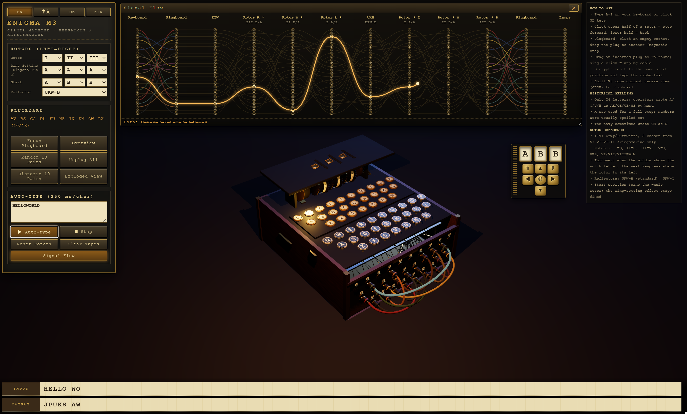

English | [简体中文](README.zh-CN.md) | [Deutsch](README.de.md)

# Enigma M3 — Interactive 3D Simulator

`enigma_m3.html` is a single-file, browser-based 3D simulation of the German WWII **Enigma M3** cipher machine. The model is built procedurally with Three.js (no external 3D models), animated with GSAP, and backed by a cryptographically authentic M3 engine.

A standalone isometric schematic diagram of the machine (lid open, showing rotors, keyboard and plugboard) is also included: [dark version](enigma-m3-schematic-diagram.html) · [light version](enigma-m3-schematic-diagram-light.html).

## Features

**Cipher engine**
- Rotors **I–VIII** with real wirings and notches: I=Q, II=E, III=V, IV=J, V=Z, VI/VII/VIII=Z+M (double notches).
- Reflectors **UKW-B** and **UKW-C**.
- Ring settings (Ringstellung) and start positions per rotor; authentic **double-stepping** anomaly.
- Plugboard (Steckerbrett) with up to **13 pairs**.
- `encryptChar()` returns the full signal path (plugboard → rotors → reflector → rotors → plugboard → lamp).

**3D model & visuals**
- Procedural walnut case, crinkle-black metal lid with windows, brass parts, parchment letter rings.
- 26 keys, 26 lamps with frosted letter windows that glow when lit, 3 rotors + reflector + entry wheel, each rotor with 26 internal copper wires, contacts and ratchet.
- Rotors are split into alphabet ring (with notch tab) and wiring core; changing the ring setting rotates the core relative to the ring.
- Internal mechanics: chassis, stepping pawls and lever, lamp sockets, key contacts, 4.5 V battery box and a wiring harness.
- **Exploded view** that separates lid, case, keyboard, lampboard, plugboard, rotors and internals.
- **Signal-path glow**: on every key press the active rotor/reflector wires, the active plug cables and the internal harness wires light up.

**Plugboard interaction**
- 26 brass double-hole sockets and 13 patch cables with sagging Bézier cables.
- Click an empty socket to spawn a plug, drag it to another socket; **magnetic snapping** with an amber guide ring and a click sound.
- Drag an inserted plug to re-route; single click unplugs the cable.
- Buttons: **Random 13 Pairs** (sequenced fly-in), **Historic 10 Pairs** (`AV BS CG DL FU HZ IN KM OW RX`, default), **Unplug All**.
- **Focus Plugboard** camera preset (rotation locked) and **Overview**.

**Operation**
- Physical keyboard A–Z or clicking 3D keys; click upper/lower half of a rotor to step it forward/back.
- **Auto-type** pasted text at 350 ms per character (umlauts in the text box are converted to AE/OE/UE/SS).
- Dual paper tapes (input/output) printed in 5-letter groups.
- **Reset Rotors**: full reset to I-II-III, rings AAA, start AAA, UKW-B.
- Synthesized Web Audio sounds: key thunk, rotor ratchet, plug snap/clunk.

**UI**
- Languages **EN / 中文 / DE** (default EN, choice remembered). EN and 中文 use a QWERTY layout; DE uses the authentic Enigma layout **QWERTZUIO / ASDFGHJK / PYXCVBNML**. Switching *into* DE clears the tapes.
- **FIX mode** (on by default, remembered): the model keeps the on-screen size of a 1920×1080 render at any window size while the background fills the whole window.
- Draggable rotor-readout widget with a brass **pan pad** (pan up/down/left/right, forward/back on the ground plane, reset view; hold for continuous motion).
- **Shift+V** copies the current camera view as JSON to the clipboard.

## How to run

Open `enigma_m3.html` in a modern desktop browser (Chrome, Edge, Firefox, Safari). An internet connection is required: Three.js r160 (via `unpkg.com`, ES module import map) and GSAP 3.12 (via `cdn.jsdelivr.net`) are loaded from CDNs. No build step or server is needed. For offline use, open `enigma_m3_offline.html` instead — Three.js and GSAP are embedded and no internet connection is required.

## Controls

| Action | Control |
|---|---|
| Encrypt a letter | Keyboard A–Z, or click a 3D key |
| Step a rotor | Click upper half (forward) / lower half (back) of a rotor, or use the Start selects |
| Rotor order / ring / reflector | Panel selects (choosing a rotor already in use swaps them) |
| Connect plugs | Click empty socket, drag to another socket |
| Re-route / unplug | Drag an inserted plug / single click it |
| Orbit / zoom camera | Mouse drag / wheel |
| Pan camera | Pan pad under the rotor readout |
| Copy camera view | Shift+V |
| Move readout widget | Drag its frame; double-click to reset position |

## Architecture

| Class | Responsibility |
|---|---|
| `EnigmaEngine` | Pure cipher logic: rotors, notches, stepping, ring settings, reflector, plugboard, signal-path output |
| `Enigma3DScene` | Procedural 3D model, materials, lights, exploded view, glow effects, render-on-demand loop |
| `PlugboardInteraction` | 13 patch cables, drag, magnetic snapping, cable curves, plug animations |
| `InteractionController` | UI panel, i18n, keyboard/pointer input, auto-type, tapes, camera presets, pan pad |

## Verification vectors

- Rotors I-II-III, UKW-B, rings AAA, start AAA, no plugs: `AAAAA` → `BDZGO`.
- Double-stepping: start ADU → ADV, AEW, BFX.
- Reciprocity: encrypting the ciphertext again with the same settings returns the plaintext.

## Historical notes

- The machine had only 26 letters: operators wrote Ä/Ö/Ü/ß as AE/OE/UE/SS, used X for a full stop, usually spelled out numbers; the navy sometimes wrote CH as Q.
- Rotors I–V were used by Army and Luftwaffe (3 chosen from 5); VI–VIII were Kriegsmarine only.
- Key caps, lamps and plugboard plates use plain sans-serif capitals, as on the original.

## Performance notes

- Static geometry is merged per material; letter rings and plate labels use texture atlases; wire glow uses temporary overlay meshes.
- Rendering happens only when something changes (camera, animations, input) and pauses when the tab is hidden; pixel ratio is capped at 1.5; small parts do not cast shadows.

## License

Released under the [MIT License](LICENSE).
